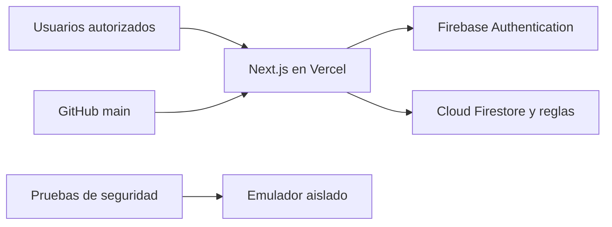

# Arquitectura y datos

Las páginas cliente acceden mediante el SDK Firebase. La autorización del servidor
reside en reglas Firestore. No hay un backend propio que valide cada movimiento.
Firebase Admin/IAM administrativo puede actuar fuera de las reglas; sus credenciales
requieren control separado.

## Mapa de componentes

| Código | Función |
| --- | --- |
| `src/app/inventario`, `conteo` | Catálogo, stock, notas, sesión física y conciliación |
| `src/app/comparar`, `reportes`, `historial` | Comparaciones, sesiones y auditoría |
| `src/app/escaner`, `usuarios`, `login` | Escaneo, autorización e ingreso |
| `src/contexts/AuthContext.js` | Sesión, editores y revocación |
| `src/lib/inventoryOperations.js` | Transacciones del stock |
| `src/lib/physicalCountOperations.js` | Transacciones del conteo |
| `src/lib/userAccess.js` | Accesos y auditoría atómica |
| `src/lib/validation.js` | Cantidades y campos |
| `src/lib/excelUtils.js`, `stockRules.js` | Planillas y clasificación |
| `src/lib/auditLog.js`, `notifications.js` | Actividad y avisos auxiliares |
| `src/components/FilterDisclosure.js` | Panel contraíble |
| `firestore.rules`, `firebase.json` | Protección y emulador |

## Colecciones Firestore

| Ruta | Campos principales |
| --- | --- |
| `products/{id}` | `sku`, `name`, `category`, `quantity`, `createdAt`, `lastUpdated`, `updatedBy`, `lastMutationId` |
| `audit_log/{id}` | `action`, `userId`, `userEmail`, `userName`, `timestamp`, `details`, `movements` opcional |
| `order_receipts/{id}` | `number`, `userId`, `timestamp`, `operationId` |
| `product_deletions/{productId}` | `productData`, `operationId`, `userId`, `timestamp` |
| `active_physical_audit/current` | `counts`, `updatedByMap`, `extraProducts`, `sessionName`, `monthKey`, estado/actualización |
| `inventory_sessions/{id}` | Nombre, autor/fecha, resumen, diferencias, tipo/estado |
| `authorized_users/{uid}` | `enabled`, nombre/correo y metadatos del cambio |
| `notifications/{id}` | Tipo, mensaje, autor, fecha, `readBy` |

Los documentos antiguos pueden carecer de campos nuevos. Las altas usan ID
`sku_` + SKU normalizado/codificado; los ID anteriores se conservan. No cambiar
ID sin migrar referencias del conteo y movimientos.
La copia de eliminación se guarda por ID de producto; una eliminación posterior
del mismo ID puede reemplazarla. No es un archivo completo de todas las bajas.

## Transacciones

`commitInventoryChanges` lee recibo y productos antes de escribir. Calcula deltas
con el stock vigente; las escrituras absolutas comprueban cantidad esperada y,
cuando corresponde, metadatos esperados. Stock, auditoría, recibo y sesión de
conciliación opcional se escriben juntos. Una baja exige copia del producto.
Las reglas contrastan cantidades/autores y evidencia mediante `getAfter`.

El SDK reintenta conflictos; el helper añade hasta tres intentos externos ante
`permission-denied` sin relajar las reglas. Los movimientos se indexan por ID
de producto dentro de la operación. En altas/bajas un extremo puede ser `null`.
Las notas normalizan mayúsculas/espacios exteriores para identificar recibos.

El conteo absoluto verifica su base; los incrementos leen el valor vigente.
La página ordena peticiones por producto y protege entradas pendientes de snapshots.
El borrador usa `localStorage`; no garantiza recuperación completa.

## Límites implementados

| Concepto | Límite |
| --- | --- |
| Cambios de stock por operación | 100 productos |
| Eliminaciones por operación | 5 |
| Valor absoluto de cantidad | 1.000.000.000; redondeo a dos decimales |
| SKU / nombre / categoría | 100 / 200 / 100 caracteres |
| Lectura Excel | 10 MB; primera hoja |
| Historial | 50 por bloque; 1 adicional para detectar continuación |
| Mapa de conteos, según reglas | 3.000 entradas |
| Diferencias por sesión, según reglas | 1.000 entradas |

Los límites propios de Firestore, incluido tamaño documental, también aplican.
Un único documento de conteo genera contención; debe rediseñarse para expansión.
Auditoría de stock y accesos es atómica. Logs auxiliares y notificaciones pueden
fallar sin revertir el movimiento principal: no son su comprobante definitivo.
